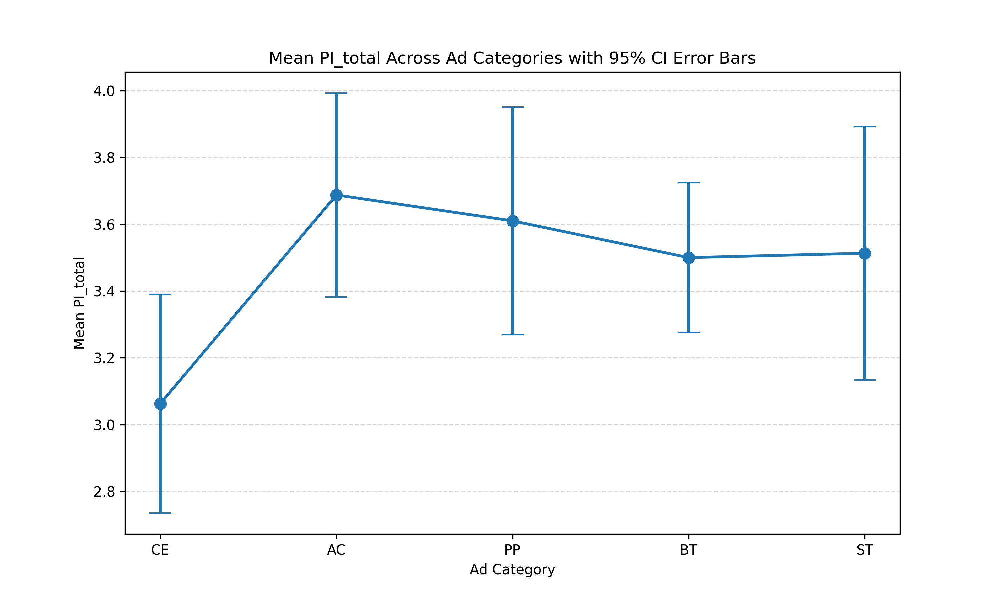
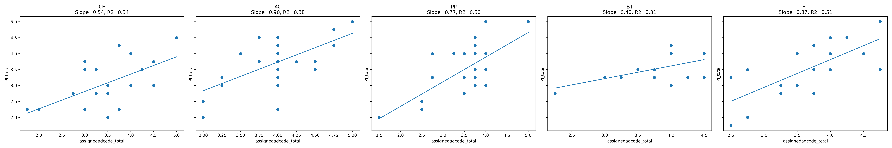

# What drives purchase intent? An advertising experiment with Indian consumers aged 18–35

Research project · IIIT Hyderabad · Sep – Nov 2025
Team: Prakash Bhabad, Snigdha Pani, Deepti Koranga · Guide: Dr. Priyanka Srivastava

**[Full report (PDF)](report.pdf)** · **[Regression report (PDF)](results/Full_Regression_Report.pdf)** · **[Questionnaire](survey/questionnaire.xlsx)**

---

## The question

Young Indian consumers are among the most digitally active and brand-conscious
buyers anywhere, and brands spend heavily on celebrity-led and creative campaigns
to reach them. What they rarely know is which part of an ad actually moves
purchase intent.

We tested five ad levers against each other:

| Code | Lever | What we measured |
|---|---|---|
| CE | Celebrity endorsement | Credibility of the celebrity: trust, expertise, appeal, believability |
| AC | Ad creativity | Originality, novelty and quality of execution |
| BT | Brand trust | Reliability, honesty and confidence in the brand's promises |
| PP | Price perception | Fairness, affordability and value for money |
| ST | Storytelling | Clarity, relatability and emotional pull of the narrative |

The starting hypothesis was that celebrity endorsement would be the strongest of the five.

---

## Answer in brief

- **Storytelling and price perception were the strongest predictors** of purchase
  intent, each explaining about half of its variation (R² 0.51 and 0.50).
- **Celebrity endorsement did worst.** People who saw the celebrity ad reported
  significantly lower purchase intent than those who saw the creativity
  (p = 0.009), brand-trust (p = 0.038) or price (p = 0.028) ads. The starting
  hypothesis was not supported.
- **Creativity, trust, price and storytelling performed at a similar level**;
  none of the comparisons between them was significant.
- **Across all five groups at once, the difference was not significant**
  (one-way ANOVA, F = 2.11, p = 0.086), so the ranking should be read as
  directional rather than settled.

**Recommendation:** lead with a story and a clear value message. A well-known
face on its own should not be assumed to convert young buyers.

---

## Study design

| | |
|---|---|
| **Design** | Randomised between-subjects survey experiment: each participant saw one video ad from one category only |
| **Delivery** | Custom survey web app (Next.js, Supabase, hosted on Vercel) handling consent, random assignment, video playback and watch-time logging |
| **Measures** | 5-point Likert items, coded A (manipulation check), B (perception of the lever), C (immediate impact) and D (purchase intention) |
| **Pilot** | 5–8 participants run through the full flow to check wording, timing and assignment before launch |
| **Quality checks** | Removed anyone finishing in under 25% of the median time, anyone who watched less than 80% of the video, and duplicate participant IDs |
| **Sample** | 128 responses collected; 103 kept after checks (CE 20, AC 24, BT 15, PP 25, ST 19) |
| **Ethics** | Informed consent, right to withdraw, anonymous participant codes, no personal data collected |

Bias controls: a neutral study description, one ad per person so the hypothesis
could not be guessed, fully online and anonymous responses, and separate stimuli
for each category.

---

## Results

### Purchase intent by group (mean, 1–5)

| CE | AC | BT | PP | ST |
|---:|---:|---:|---:|---:|
| 3.06 | **3.69** | 3.50 | 3.61 | 3.51 |



### Does perception of the lever predict purchase intent? (regression within each group)

| Lever | Slope (β) | R² | n |
|---|---:|---:|---:|
| Storytelling | 0.87 | **0.51** | 19 |
| Price perception | 0.77 | **0.50** | 25 |
| Ad creativity | **0.90** | 0.38 | 24 |
| Celebrity endorsement | 0.54 | 0.34 | 20 |
| Brand trust | 0.40 | 0.31 | 15 |

A slope of 0.87 means a one-point rise in how well people rated the storytelling
went with a 0.87-point rise in purchase intent.



### Which groups differ? (Welch's t-tests, unequal variances)

| Comparison | t | p | Result |
|---|---:|---:|---|
| AC vs CE | 2.74 | 0.009 | Creativity higher |
| PP vs CE | 2.27 | 0.028 | Price higher |
| BT vs CE | 2.16 | 0.038 | Trust higher |
| ST vs CE | 1.76 | 0.086 | Storytelling higher, not significant |
| All other pairs | — | > 0.33 | No difference |

Full tables: [`results/t_test_between_groups.xlsx`](results/t_test_between_groups.xlsx),
[`results/anova/anova_results.xlsx`](results/anova/anova_results.xlsx).

---

## How far these results go

- **Within-group regressions are correlational.** They show that people who rated
  a lever higher also reported higher intent, not that the lever caused it.
- **Between-group comparisons are the causal ones**, because people were randomly
  assigned to an ad, but each group had only 15–25 people.
- **Ten pairwise t-tests raise the chance of a false positive**, which is why the
  non-significant ANOVA matters.
- **One ad per category.** Results may reflect the specific video as much as the
  lever, and real ads mix cues (a story ad can also be creative).
- **Self-reported intent**, not actual purchases, and a sample skewed towards 18–25.
- The C items (impact) were collected for mediation analysis, which the sample
  was too small to support.

---

## Analysis pipeline

All analysis is in Python: pandas, scikit-learn (linear regression), SciPy (t-tests, ANOVA), RapidFuzz (matching answers to question codes) and matplotlib.

| Step | Script | What it does |
|---|---|---|
| 1 | `analysis/convert-parsed-response.py`, `analysis/parse.py` | Turn the raw JSON survey export into one row per participant, split by ad group |
| 2 | `analysis/Cleaned.py` | Match each answer to its question code (A1–D4) with fuzzy text matching, drop duplicates, apply the attention and watch-time checks |
| 3 | `analysis/regression_scatterPlot.py`, `analysis/regression_scatterPlot_All.py` | Score perception (B) and purchase intent (D), fit a regression per group, write plots and the regression report |
| 4 | `analysis/T_test.py` | Pairwise t-tests on purchase intent between groups |
| 5 | `analysis/anova_plot.py`, `analysis/anova_plot_mean_error.py`, `analysis/Box_plot.py` | One-way ANOVA, box, violin and mean plots |

**Data.** Participant responses are not included in this repository. Participants
were told their data would be used only for this research, so only aggregated
results are published here.

---

## Repository layout

```
report.pdf                     full project report
analysis/                      Python scripts, steps 1–5 above
results/
  All_Regression_Plots.png     all five regressions on one figure
  Full_Regression_Report.pdf   regression output and interpretation per group
  all_interpretations.txt      the same, as text
  t_test_between_groups.xlsx   pairwise t-test table
  regression/                  per-group regression results and scatter plots
  plots/                       per-group regression plots
  boxplots/                    each group against all others
  anova/                       ANOVA table, box, violin and mean plots
survey/
  questionnaire.xlsx           every item with its code and ad group
  questions.json               the item bank used by the survey app
```

---

## References

- McCracken, G. (1989). Who is the celebrity endorser? Cultural foundations of the endorsement process. *Journal of Consumer Research*, 16(3), 310–321.
- Agrawal, J. (1996). Effect of brand loyalty on advertising and consumer response. *Journal of Marketing Research*, 33(1), 76–91.
- Haider, T., & Shakib, S. (2018). A study on the influences of advertisement on consumer buying behavior. *Business Studies Journal*, 9(1), 1–10.
- Choudhary (2021). Creativity and storytelling in advertising.
- Vrtana, L., & Krizanova, A. (2023). Emotional storytelling in advertising: drivers of impulsive buying among youth. *Sustainability*, 15(13), 13337.
- Kothari, R., Sharma, A., & Singh, P. (2025). Digital authenticity and consumer trust in influencer marketing: evidence from India. *Frontiers in Communication*, 10.
- Bain & Company (2025). How India Shops Online.
